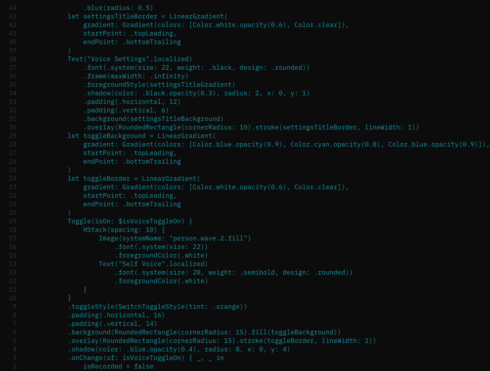

# MinimalX

A minimal, developer-friendly Neovim color scheme designed for dark mode with customizable colors.



*Theme preview showing how MinimalX looks with Swift code*

## Features

- **Minimal Design**: Clean, distraction-free interface
- **Dark Mode Only**: Optimized for dark backgrounds with high contrast for long coding sessions
- **Customizable**: Easy-to-modify color variables
- **Consistent**: Uniform syntax highlighting with subtle variations

## Colors

The theme uses a carefully designed color palette optimized for dark mode:

- **Background**: `#1a1a1a` - Very dark background for reduced eye strain
- **Foreground**: `#22a6b3` - Teal text for main code
- **Comments**: `#666666` - Subtle gray for comments
- **Line Numbers**: `#444444` - Medium gray for line numbers
- **Visual Selection**: `#4a4a4a` - Dark gray for selected text
- **Telescope Selection**: `#555555` - Medium gray for telescope highlights

## Installation

### Using a plugin manager (recommended)

#### Packer

```lua
use 'TemelGunaydin/minimalx.nvim'
```

#### Lazy.nvim

```lua
{
  'TemelGunaydin/minimalx.nvim',
  lazy = false,
  priority = 1000,
  config = function()
    vim.cmd.colorscheme 'minimalx'
  end,
}
```

#### vim-plug

```vim
Plug 'TemelGunaydin/minimalx.nvim'
```

### Manual installation

```bash
git clone https://github.com/TemelGunaydin/minimalx.nvim ~/.local/share/nvim/site/pack/plugins/start/minimalx.nvim
```

## Usage

Add this to your Neovim configuration:

```lua
vim.cmd.colorscheme 'minimalx'
```

Or in VimScript:

```vim
colorscheme minimalx
```

## Customization

You can easily customize the colors by editing the variables at the top of `lua/minimalx/dark.lua`:

```lua
-- Define background and foreground colors as variables for easy modification
local bg_color = "#1a1a1a"  -- Background color
local fg_color = "#22a6b3"  -- Foreground text color
local visual_color = "#4a4a4a"  -- Visual selection color
local telescope_selection_color = "#555555"  -- Telescope selection color
local comment_color = "#666666"  -- Comment color
local line_number_color = "#444444"  -- Line number color
```

## Requirements

- Neovim 0.5.0 or higher
- `termguicolors` enabled

## License

MIT License - see LICENSE file for details.

## Contributing

Feel free to submit issues and enhancement requests!
