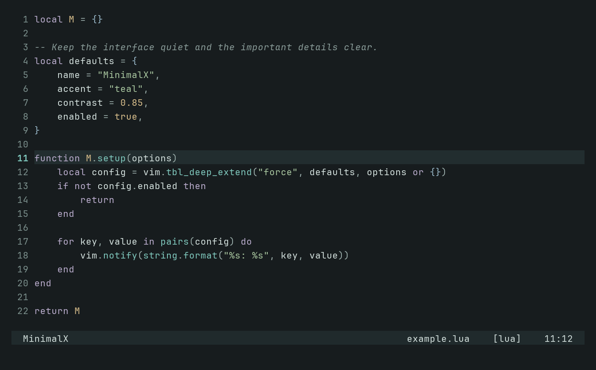

# MinimalX

A minimal dark colorscheme for Neovim, built around a charcoal background, soft teal accents, and readable syntax. Muted colors give code a clear hierarchy while keeping the editor calm.



## Features

- Soft off-white text with distinct colors for functions, strings, keywords, types, and constants.
- Readable comments and line numbers, with a subtle active-line highlight.
- Clear visual selections, search matches, floating windows, and completion menus.
- Separate colors for errors, warnings, information, hints, and Git changes.
- Classic Vim syntax, Tree-sitter captures, and LSP semantic token highlights.
- A complete 16-color terminal palette, including distinct error and success colors.
- Highlight groups for Telescope, nvim-tree, bufferline, nvim-cmp, blink.cmp, Gitsigns, Snacks, Neogit, CoC, and Compile Mode.
- No plugin dependencies or setup function required.

## Requirements

- Neovim 0.9 or newer.
- A terminal or GUI with true-color support. MinimalX enables `termguicolors` and uses a dark background automatically.

Tree-sitter, an LSP client, and the plugins listed above are optional. MinimalX provides their highlight groups; install and configure those tools separately if you use them.

## Installation

### lazy.nvim

Add this plugin specification to your configuration:

```lua
{
    "TemelGunaydin/minimalX",
    lazy = false,
    priority = 1000,
    config = function()
        vim.cmd.colorscheme("minimalx")
    end,
}
```

### packer.nvim

```lua
use({ "TemelGunaydin/minimalX" })
```

### vim-plug

```vim
Plug 'TemelGunaydin/minimalX'
```

### Native Neovim packages

```sh
git clone https://github.com/TemelGunaydin/minimalX.git \
    "${XDG_DATA_HOME:-$HOME/.local/share}/nvim/site/pack/themes/start/minimalX"
```

For packer.nvim, vim-plug, or native packages, activate the theme after your plugins load:

```lua
-- init.lua
vim.cmd.colorscheme("minimalx")
```

```vim
" init.vim
colorscheme minimalx
```

You can also try it in a running session with `:colorscheme minimalx`.

## Palette

| Role | Color |
| --- | --- |
| Background | `#171c1e` |
| Floating panels | `#202a2c` |
| Foreground | `#d2dfdc` |
| Comments | `#899b98` |
| Line numbers | `#7b8f8c` |
| Teal / functions | `#7fc8bd` |
| Green / strings | `#a9c7a0` |
| Purple / keywords | `#b9accc` |
| Blue / types and information | `#9ab9ca` |
| Amber / constants and warnings | `#d9bf8c` |
| Red / errors and deletions | `#df9692` |
| Selection | `#334b4c` |

## Customization

Override individual highlight groups after loading the theme. For example, to use upright comments:

```lua
vim.cmd.colorscheme("minimalx")
vim.api.nvim_set_hl(0, "Comment", { fg = "#899b98", italic = false })
```

Tree-sitter and LSP groups link to the base syntax groups, so this override also applies to linked comments. To retain your overrides when switching or reloading colorschemes, register a `ColorScheme` autocmd before activating MinimalX:

```lua
vim.api.nvim_create_autocmd("ColorScheme", {
    group = vim.api.nvim_create_augroup("MinimalXOverrides", { clear = true }),
    pattern = "minimalx",
    callback = function()
        vim.api.nvim_set_hl(0, "Comment", { fg = "#899b98", italic = false })
        vim.api.nvim_set_hl(0, "CursorLine", { bg = "#202a2c" })
    end,
})

vim.cmd.colorscheme("minimalx")
```

For a fork with a different palette, edit the color table at the top of [`lua/minimalx/dark.lua`](lua/minimalx/dark.lua). Syntax, diagnostics, terminal colors, and plugin groups share that palette.

## Development

From the repository root, run the dependency-free checks with Neovim:

```sh
nvim --clean -n --headless -i NONE -l tests/theme.lua
```

The checks cover startup from a light background, disabled syntax, text contrast, syntax in a Lua buffer, diagnostic and diff states, terminal colors, plugin highlight links, and colorscheme reloads.

## License

[MIT](LICENSE).
